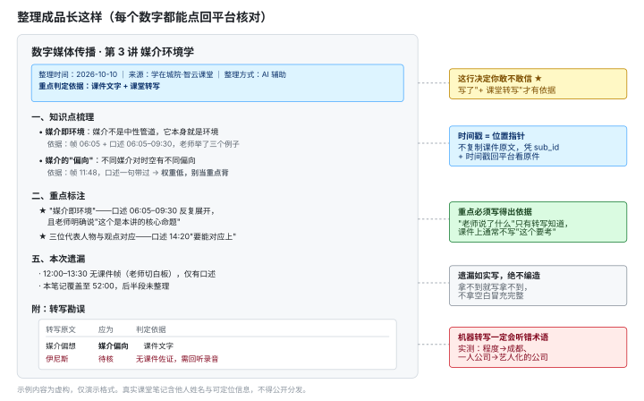
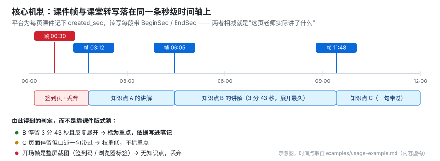

# zucc-zhiyun-course-digest

> **学在城院 · 智云课堂课后整理助手**
> 让**能操作浏览器的 AI 助手**（Qoder / Cursor / Claude Desktop 等）
> 把智云课堂某一节课的课件与课堂录音，整理成一份带依据的 Markdown 笔记。
>
> 你只需要在它打开的窗口里登录一次，之后取数、读课件、对齐时间轴、出笔记全部由 AI 做完。
> 打不开浏览器的网页版 AI 只能帮你整理你自己导给它的内容——见「如果你的 AI 不能操作浏览器」。

[](LICENSE)
[](https://github.com/xsjdye/zucc-zhiyun-course-digest/releases/latest)

⚠️ 非浙大城市学院官方项目，仅供同学**个人学习**使用。请遵守学校相关规定。

---

## 整理成品长这样



**这不是设计稿，是真跑出来的格式。** 用真实账号试跑一门 2 小时的全校公选课：

| 实测项 | 结果 |
|---|---|
| 平台自带语音转写 | 1869 段 / 35410 字，可直接取用 |
| 课件帧 | 346 帧，每帧带出现时刻 |
| 只取前 15 分钟 | 199 段 → 合并为 26 段可读文本，9 帧课件 |
| 转写错词 | 抓到 13 处，已列入笔记自带的「勘误表」 |

完整示例见 [`examples/usage-example.md`](examples/usage-example.md)（内容虚构，格式真实）。

---

## 30 秒上手

### 第 0 步：先拿到这几个文件

不会用 git 也没关系，两种办法任选：

- **下整个仓库**：浏览器打开 <https://github.com/xsjdye/zucc-zhiyun-course-digest> → 绿色 `Code` 按钮 →
  `Download ZIP` → 解压。或直接访问
  <https://github.com/xsjdye/zucc-zhiyun-course-digest/archive/refs/heads/main.zip>
- **只要两个文件**：在浏览器里打开下面两个链接，右上角复制原文即可
  - [`PROMPT.md`](PROMPT.md) —— 粘给 AI 的说明书
  - [`scripts/fetch-lesson.js`](scripts/fetch-lesson.js) —— 取数脚本

### 然后三步

1. 在**自己的电脑浏览器**登录 <https://classroom.hzcu.edu.cn/>
2. 打开 [`PROMPT.md`](PROMPT.md)，**全选复制**，粘到你 AI 对话框的最开头
3. 说一句：

```
整理咱们的课：<课程名>，<YYYY-MM-DD> 那节
```

**你的密码只存在你自己的设备上。** 本工具全程不接触、不记录、不上传账号密码，也不需要 token。

> 第一次用如果 AI 打开的浏览器里没登录，它会让你**在它打开的那个窗口里登录一次**——
> 这是正常的，登一次以后就不用再登了。详见「排错速查」。

---

## 换一台电脑第一次跑，先确认这四件事

这个 skill 在我的机器上跑通过 ≠ 在你的机器上能跑通。冷启动最容易卡在这四处：

| # | 要确认的 | 怎么确认 | 不通怎么办 |
|---|---|---|---|
| 1 | **能不能看到 AI 打开的浏览器窗口** | 让 AI 打开 classroom，你这边要有页面出现、能点进输入框 | 看不到就让它切可见 / 前台窗口；实在切不了，这个 AI 就走降级（你导内容给它整理） |
| 2 | **有没有登录态** | 页面停在 `classroom.hzcu.edu.cn` 就是已登录；跳到 `ca.hzcu.edu.cn` 就是没登录 | 在那个窗口登录一次即可，之后不用再登 |
| 3 | **域名对不对** | 地址栏必须是 `classroom.hzcu.edu.cn` | 在 `education.hzcu.edu.cn` 等其它城院域名下跑会报 `Failed to fetch` |
| 4 | **有没有 Python**（只有跑自检脚本才需要） | 终端输 `python3 --version`（Windows 用 `python --version`） | 没有也没关系：取数走的是浏览器控制台，**不依赖 Python**。只是上传前的隐私扫描要另找机器跑 |

前三条是取数主流程，第四条只影响自检工具。

---

## 它凭什么能标出重点

多数"AI 整理课件"只能看课件写了什么，而**课件上通常不写"这个要考"**。

智云课堂把**每页课件的出现时刻**和**课堂语音转写的每段起止秒数**放在同一条时间轴上，
所以能算出"这一页，老师实际讲了什么、讲了多久"：



于是重点判定有了依据，而不是靠版式猜：

| 拿到了什么 | 能判断出的重点 | 可靠度 |
|---|---|---|
| 课件 + 平台转写（**有回放的课通常都有**） | 反复展开讲的、明说"要考/要交"的、课件加粗或单独成页的 | ✅ 有依据 |
| 只有课件，转写没生成 | 课件里加粗的、篇幅大的、反复出现的 | ⚠️ **属于推测** |

笔记头部固定有一行**「重点判定依据」**，写清这次是哪一种。

> 一句话：**这是帮你省事的草稿机，不是考点预言机。**
> 复习以你自己的课堂记录和课件原文为准。机器转写一定会听错术语（实测 `程度`→`成都`、
> `一人公司`→`艺人化的公司`、`起号`→`洗好`），所以笔记自带勘误表。

---

## 主路径：AI 全自动，你只需要登录一次

你要做的只有两件事——**把 `PROMPT.md` 粘给 AI**，以及**第一次在 AI 打开的窗口里登录一下**。
之后全部由 AI 自己做，不需要你下载、不需要你跑脚本、不需要你导内容：

```
你说：整理咱们的课：<课程名>，<日期> 那节
AI 做：打开 classroom →（没登录就请你登一次）→ 取课表 → 取平台转写
        → 取课件帧 → 读图 → 按时间轴对齐 → 出笔记
```

前提只有一个：你的 AI 能操作浏览器。

| 工具 | 要配什么 |
|---|---|
| Qoder 桌面版 | 开启 Browser Connector（浏览器连接） |
| Cursor | 配置 Playwright 类 MCP 服务 |
| Claude Desktop | 配置浏览器自动化类 MCP 服务 |

AI 在页面里跑的是 [`scripts/fetch-lesson.js`](scripts/fetch-lesson.js)：

```js
await zccFetch('2026-10-15', '数字媒体')                  // 整节
await zccFetch('2026-10-15', '数字媒体', {maxSec: 900})    // 只要前 15 分钟
```

**"零依赖"仍然成立**——这个脚本的运行环境就是浏览器本身，你不用装任何东西。

## 如果你的 AI 不能操作浏览器

网页版 / App 版 AI（豆包、Kimi、通义、ChatGPT 等）**碰不到你的浏览器**，因此取不到数据。
这时只能走兜底：你把内容导给它，它负责整理。格式一样，但重点判定会降级为推测。
流程见 [`examples/fallback-example.md`](examples/fallback-example.md)。

> 想要自动取数，就用一个能操作浏览器的 Agent 工具，这是主路径唯一的硬前提。
>
> （`fetch-lesson.js` 也可以由用户自己在浏览器控制台跑一次来喂数据，
> 但那是**进阶用法、不是推荐路径**——让同学去粘控制台脚本，跟"方便"是反的。
> 说明留在 [`scripts/README.md`](scripts/README.md)。）

---

## 笔记包含什么

| 板块 | 内容 |
|---|---|
| 骨架 | 一张结构图 / 层级图，10 秒看懂课的主线 |
| 第 N 段（HH:MM–HH:MM） | **段内成段叙述**，【课】带依据、【延】按 persona 视角补（不计入重点） |
| 重点 | ★ 一句话说明依据，**【延】不作为重点依据** |
| 待办 | 作业、预习要求 |
| 遗漏 | 没拿到的资料，如实写"无" |
| 转写勘误 | 「原文 → 应为 → 依据」；纠正不了的标「待核」 |

时间粒度按"段"（约一节课 40 分钟）控制，**正文里不堆秒级时间戳**。要精确回听时看每段末尾的 `> 回听：…`。

要长期归档进 Obsidian 的话，`templates/` 里有三件套：一讲一份（`lecture.md`）、一门课一份索引、
全部课程一份总索引。**归档必须同时更新两级索引**——只写课时文档不更新索引，是这套笔记最容易烂掉的地方。

---

## 隐私与合规（分享 / 上传前必读）

### 🔴 最容易出事的一条：同学的姓名

课堂逐字稿里**天然含点名环节和同学发言的真实姓名**——这些同学从没同意过被公开，
泄露他们比泄露你自己严重得多。

| 必须做 | 说明 |
|---|---|
| 点名 / 同学回答 / 小组分工里的姓名 → 匿名化为「同学A」 | **整理时就做**，别等上传前才补救 |
| 含他人姓名的逐字稿**不得**推到任何公开位置 | 教室编号、精确课表、选课人数同理 |
| `examples/` 只放虚构数据 | 本仓库里的示例全部是编的 |

### 🔴 第二条：课件帧链接免登录就能打开

实测：不带任何 Cookie，课件帧 URL 返回 200。

**这条在本仓库里是作为「风险」记录的，不是作为技巧。** 它意味着链接本身就是访问凭证，
平台无法校验点链接的人是否选了这门课。所以：

- **不要把 `video.hzcu.edu.cn/ai3/ppt/…` 贴进仓库、issue、群聊或任何公开位置**
- 为整理而下载到本地的帧图，读完即删，且**不要放在仓库目录内**（放 `output/`，已被 `.gitignore` 排除）
- 帧图是**整屏截图**，实测里面出现过签到二维码、签到进度（已签 N/总人数）、
  老师浏览器标签页与系统任务栏 → 一律不上传
- 认为这个行为该被修正，请把 [`scripts/api-contract.md`](scripts/api-contract.md) 第 2 节发给学校信息中心判断，
  **不要自己去验证边界**

### 凭据与使用边界

- **本工具不需要 token，也不该去拿 token。** 实测只要 Cookie 就能取数。
  浏览器里的资源列表 URL **会带出完整 token**，一旦进入对话、日志或截图就收不回来 → **不要 dump 资源列表**
- 任何凭据**绝不写进会提交的文件**；`config/`、`cookies*.json`、`privacy-keywords.txt` 已被 `.gitignore` 排除
- **只做你本人登录后本来就能看到的事。** 换别人的 `user_id`、枚举不属于自己的 `sub_id`
  属于未授权的访问控制测试——**本仓库没做过，也不建议任何人做**
- 不高频、不并发、不批量抓取；遇验证码 / 风控立即停手转手动
- 仓库中出现的 `yjapi.hzcu.edu.cn` 等端点，是学校下发给每个登录学生的前端 JS 里的明文，
  不是逆向得到的秘密；但它仍受平台改动影响，接口 404 时先看你自己的网络面板
- **若学校提出要求，会立即移除相关说明**

### 上传前必跑这两条

```bash
# macOS / Linux
python3 scripts/privacy-scan.py --selftest   # 先确认扫描器本身有效
python3 scripts/privacy-scan.py              # 再扫仓库

# Windows（没有 python3 这个命令，用 python）
python scripts\privacy-scan.py --selftest
python scripts\privacy-scan.py
```

> 退出码非 0 就**不要上传**。
> Windows 若显示乱码，先执行 `chcp 65001` 再跑（不影响判定结果，脚本内部已做编码兜底）。

它只看"git 认为会被上传的文件"，所以 `output/` 里的真实笔记不会误报；
但你一旦把真实笔记挪进 `examples/` 这类会提交的位置，就会被拦住。

---

## 常见问题

**Q：我没有编程基础，能用吗？**
能。不用装任何软件，也不用你做任何取数操作——只要你的 AI 能操作浏览器，你要做的就只有第一次登录那一下。

**Q：我要把密码给 AI 吗？**
**不要。** 你自己先在浏览器登录，然后要么 AI 复用你已登录的会话，要么你自己在控制台跑脚本。
两条路都不把凭据交给 AI。**任何要你交出密码的做法都不对。**

**Q：还要我自己录音、跑转写模型吗？**
**通常不用。** 有回放的课平台自带转写，`zccFetch()` 直接拿到。
只有转写没生成时才需要本地转写兜底——选模型前**先体检电脑**（内存 / 芯片 / 有无独显），
见 [`scripts/asr-setup.md`](scripts/asr-setup.md)。

**Q：课件是 PPT，AI 读不到正文吧？**
平台把每页课件截成 1280×720 的图，并记录了每页出现的时刻。
AI 是**读图**而不是解析 `.pptx`——有视觉能力的 AI 不需要装 OCR。

**Q：用网页版 AI 安全吗？**
整理环节没问题，但你粘给它的课程内容会**进入那个平台**，请自行确认其数据政策。
尤其别把同学的真实姓名粘过去。

---

## 排错速查

| 情况 | 怎么办 |
|---|---|
| **登录页闪一下就没了** | AI 在重定向途中**又导航了一次**。别再导航，让登录页停住，你自己输完账号密码，再让 AI 重新判定登录态 |
| **登录页报 `ERR_TUNNEL_CONNECTION_FAILED` / 拒绝连接** | `ca.hzcu.edu.cn` **只有 HTTP，没有 HTTPS**。确认地址栏是 `http://` 开头；不行就关掉浏览器"始终使用安全连接"，或改用能开浏览器的 Agent 工具（降级路径不需要这个域名） |
| AI 报 `ERR_ABORTED` / `chrome-error` 打不开 classroom | **不是站点挂了**。未登录时 `classroom` 返回 200 + 前端外壳，由 SPA 用 JS 跳去 `ca.hzcu.edu.cn/cas/login`，工具把这一跳的中断误报成了失败 |
| AI 的浏览器里没有登录态 | 正常，第一次用都会这样。在它打开的登录页里登一次就行，之后不用再登 |
| 脚本报 `Failed to fetch` | 你不在 `classroom.hzcu.edu.cn` 域下。城院其它域名（如 `education.hzcu.edu.cn`）会被跨域策略拦掉 |
| AI 说"我不能打开浏览器" | 那是网页版 / App 版 AI 的限制，它取不到数据，只能帮你整理你导给它的内容。要全自动请换能操作浏览器的 Agent 工具 |
| AI 要你提供账号密码 | **不要给。** 提醒它复用已登录会话或让你自己跑脚本；坚持要就换个 AI |
| 课件只拿到 10 条 | 你传了 `page` / `per-page`。**不传分页参数会一次返回全部** |
| 逐字稿糊成几大块 | 合并规则缺跨度上限，用 `fetch-lesson.js` 里的规则（间隔≤2s 且 跨度<40s 且 字数<220） |
| `transcript.available` 是 false | 该课转写未生成或无回放 → 走本地转写兜底，或如实标注"仅基于课件" |
| 一节课太长、整理不完 | 用 `{maxSec: 900}` 先跑前 15 分钟；或按时间段分批 |
| 想要更简 / 更详细 | 直接说"要精简版"或"要详细版"，AI 会切换详略档位 |

登录态也不用靠猜：`zccFetch()` 跑通就是已登录；返回 `未传入token` 就是还没登录，再登一次即可。

接口字段、返回结构、全部已知坑，写在 [`scripts/api-contract.md`](scripts/api-contract.md)。

---

## 仓库结构

```
zucc-zhiyun-course-digest/
├── README.md              本文件
├── SKILL.md               ★ 核心：给 AI 读的完整执行说明
├── PROMPT.md              纯提示词单文件版（复制给任意 AI 即可整理；取数要 AI 能开浏览器）
├── LICENSE                MIT
├── CHANGELOG.md           更新日志
├── assets/                本文件的示意图
├── examples/
│   ├── note-template.md   输出模板（模板契约的事实源）
│   ├── usage-example.md   正常路径示例（有平台转写）
│   └── fallback-example.md 降级路径示例（无转写 / 无浏览器）
├── templates/             归档进 Obsidian 时用
│   ├── lecture.md         一讲一份
│   ├── course-INDEX.md    一门课的索引
│   └── master-INDEX.md    全部课程的总索引
└── scripts/
    ├── README.md          本目录说明
    ├── fetch-lesson.js    ★ 取数脚本：浏览器控制台粘一次即可
    ├── api-contract.md    接口契约与实测坑清单
    ├── asr-setup.md       本地转写兜底：先体检电脑再选模型
    ├── privacy-scan.py    上传前隐私扫描（含 --selftest）
    ├── check-template-sync.py  模板一致性自检
    └── probe-api.sh       接口手工探测（只在没有浏览器环境时用）
```

---

## 免责声明

- 本项目是**个人学习工具**，非浙大城市学院官方项目
- 使用本项目产生的任何后果由使用者自行承担
- 请勿用于违反学校规定或相关法律法规的用途
- 整理结果由 AI 生成，**不保证准确**，请自行核对

## 许可

[MIT License](LICENSE) © 2026 hgyyt
